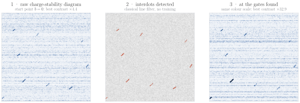
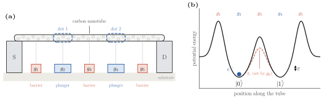
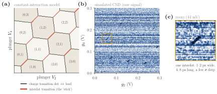
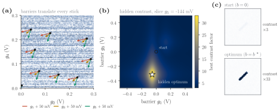
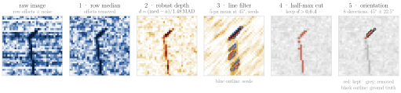
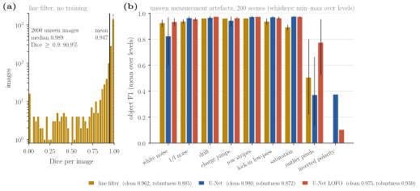
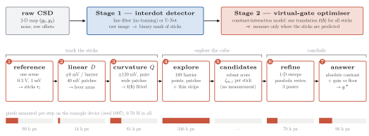
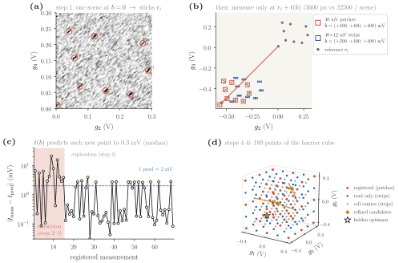
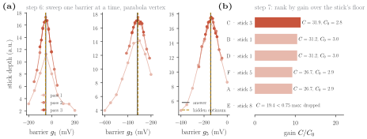
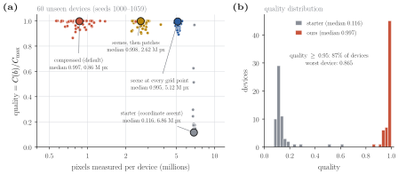

# Automated calibration of a carbon-nanotube double quantum dot

**Interdot detection and contrast optimisation on the C12 device simulator** — Team 1, QuantX × C12 hackathon (Kremlin-Bicêtre, 1–2 October 2026), **2nd place**.

<p align="center">
  
</p>

A spin qubit in a carbon nanotube is only usable once its gate voltages put one electron in a well-defined double well, at the point where the interdot transition is most visible. Today a physicist finds that point by hand, chip after chip. This repository automates the two steps the hackathon asked for, on C12's simulator of a five-gate double quantum dot:

1. **Detect** the interdot transitions ("sticks") in a raw charge-stability diagram;
2. **Find the gate voltages** that maximise their contrast on a fresh device, with as few measured pixels as possible.

The guiding constraint was the organisers' own: everything must transfer to a real fridge, where the simulator's hidden state is not available and every pixel costs acquisition time.

| | Method | Result on unseen data |
|---|---|---|
| **Detection** | Matched line filter + robust statistics, no training | mean Dice **0.947**, median **0.989** (2000 images) |
| | U-Net + physical preprocessing, tested leave-one-family-out | object F1 **0.975**; robustness to unseen artefacts **0.930** (plain U-Net: 0.872) |
| **Optimisation** | Constant-interaction model ⇒ one translation for all sticks ⇒ virtual gates + sparse exploration of the barrier cube | median quality **0.997** with **0.86 M pixels**, vs 0.116 with 6.86 M for the starter (60 devices) |

Every number in this README is produced by the code of this repository, on fixed seeds that were never used for tuning (see [Reproducing](#reproducing)).

## Contents

1. [The physical problem](#1-the-physical-problem)
2. [Stage 1 — interdot detection](#2-stage-1--interdot-detection)
3. [Stage 2 — contrast optimisation](#3-stage-2--contrast-optimisation)
4. [Results](#4-results)
5. [Limitations and next steps](#5-limitations-and-next-steps)
6. [Reproducing](#reproducing) · [Repository layout](#repository-layout) · [Team and credits](#team-and-credits) · [References](#references)

---

## 1. The physical problem

### A double well in a nanotube

A carbon nanotube is suspended over five electrostatic gates. The three **barrier** gates $g_1, g_3, g_5$ raise tunnel barriers along the tube; the two **plunger** gates $g_2, g_4$ lower the potential between them. The result is two quantum dots in series: an electron trapped in the left well ($|0\rangle$) or in the right well ($|1\rangle$) is the qubit's charge degree of freedom. The detuning $\varepsilon$ between the wells is set by the plungers, the tunnel coupling $t_c$ between them mostly by the central barrier.

<p align="center"></p>

### The charge-stability diagram

Sweeping the two plungers and recording a charge-sensitive signal gives a **charge-stability diagram** (CSD). In the constant-interaction model each dot $i$ has a capacitance to its neighbours, the dots are coupled by a mutual capacitance $C_m$, and the stable charge configuration $(N_1, N_2)$ is the one that minimises the electrostatic free energy

```math
F(\mathbf N) = \tfrac12\,\mathbf N^{\top}\mathbf E\,\mathbf N - \mathbf N\cdot\mathbf u,
\qquad
\mathbf E = e^2\,\mathbf C^{-1} = \begin{pmatrix} E_{C1} & E_{Cm} \\ E_{Cm} & E_{C2} \end{pmatrix},
\qquad
\mathbf u = |e|\,\boldsymbol\alpha\,\mathbf v ,
```

where $\mathbf v = (V_1, \dots, V_5)$ are the gate voltages and $\boldsymbol\alpha = \mathbf C^{-1}\mathbf C_g$ the matrix of lever arms. The plane is tiled by hexagons, one per configuration. Their short edges of positive slope are the **interdot transitions** $(N_1{+}1, N_2) \leftrightarrow (N_1, N_2{+}1)$: the only places where an electron can move from one dot to the other, hence where the qubit lives. On the measured diagram they are short, dark segments at about 45°: the *sticks*.

<p align="center"></p>

In the simulator, a raw $0.3 \times 0.3$ V diagram contains a handful of sticks 1–2 px wide and 4–8 px long (0.35 % of the pixels), buried in white noise and in a strong offset that changes from one scan line to the next (charge-sensor drift).

### What has to be calibrated

The barriers do two things at once (panel (a) below is the ground truth of one device, shown for illustration only):

* they **translate** every stick across the $(g_2, g_4)$ plane, so a window aimed at a stick at one setting misses it at another;
* they set the **contrast** of the sticks, through a landscape hidden in barrier space: the diagram is split into regions, each with its own Lorentzian peak, and only one of them holds the global optimum.

<p align="center"></p>

The task is therefore a five-dimensional search ($g_1, \dots, g_5$) for a narrow peak (half-width ≈ 0.1 V in a 1 V cube), in which the objective can only be read off noisy images of objects that keep moving. The rules of the challenge forbid reading the hidden state (`exp.reveal()` is used only to score answers afterwards) and count every measured pixel.

---

## 2. Stage 1 — interdot detection

Two detectors were built, with opposite inductive biases: a classical pipeline that encodes what a stick physically is, and a network that learns it.

### 2.1 Line filter (no training) — [`stage1_linefilter/`](stage1_linefilter)

A stick is a dip of uniform depth along a known direction (45°), a few noise standard deviations deep. Each operation of the pipeline exploits one of these facts:

<p align="center"></p>

1. **Row median.** Each scan line carries its own offset, as large as the pixel noise. Subtracting the median of each row removes it without attenuating the sticks, which occupy a few pixels of a row and do not move its median.
2. **Robust depth.** Every pixel becomes a depth in noise units, $d = (\mathrm{median} - a)/(1.4826\ \mathrm{MAD})$. Median and MAD estimate the background and its noise without being pulled by the sticks, so every threshold below is in units of $\sigma$ whatever the device.
3. **Matched line filter.** Averaging over $L = 5$ px along the stick direction keeps the dip and divides white noise by $\sqrt L$: the signal-to-noise ratio of a faint stick gains a factor ≈ 2.2. Seeds are pixels whose filtered depth exceeds $3.5\ \sigma$; dilated by 2 px, they bound the region where pixels deeper than $2\ \sigma$ are kept (a $2\ \sigma$ threshold alone would keep 2 % of the background).
4. **Half-maximum cut.** Within each connected component of amplitude $A$, only pixels with $d > 0.6\ A$ are kept, and components with $A < 3\ \sigma$ are dropped: the mask stops where the dip falls to about half its depth, whatever the contrast of the stick.
5. **Orientation test.** Fragments of the charge lines that end on the sticks pass the previous steps. The image is averaged along 8 directions; a component is kept only if its darkest direction lies within 45° ± 22.5°. This works on components of a few pixels, whose shape carries no reliable orientation (in the figure, the vertical charge line is removed, the stick is kept).

The six parameters were tuned by an automated search loop on a generated tuning set (`generate_dataset(seed=1)`), checked on a validation set (seed 2), and are reported here on 2000 images of a third seed (2026) never seen during tuning.

### 2.2 U-Net and leave-one-family-out robustness — [`stage1_unet/`](stage1_unet)

*Developed jointly with Romain Auguste.*

* **Architecture.** A U-Net (1.9 M parameters, three poolings): sticks are local and sub-pixel, so a convolutional encoder–decoder whose skip connections carry the 1-px detail back to full resolution has exactly the right bias.
* **Training on an infinite generator.** 30 000 geometries are precomputed; contrast and noise are redrawn at every batch, so no image is seen twice. The contrast is drawn log-uniformly so that faint sticks — the regime of stage 2 — are well represented. Only the exact symmetries of the device are used for augmentation (transpose, 180° rotation, anti-transpose): a plain flip would turn 45° sticks into −45° ones, i.e. another device.
* **Metric.** The official mask is a thresholded, blurred rectangle that is often fragmented, so pixel Dice partly measures pixelisation luck. Detectors are compared on an **object F1**: a stick is found if a predicted pixel lies within half its length + 1 px of its centre.
* **The failure.** On a robustness suite of 25 sets (9 laboratory artefacts the generator never produces, up to 3 levels each: white and 1/f noise, drift, charge jumps, stripes, lock-in low-pass, saturation, outlier pixels, inverted polarity) the U-Net loses accuracy: robustness score 0.872, where the score is the mean of obj F1(perturbed) / obj F1(clean).
* **The remedy.** `PhysInput`, a layer without learned parameters placed in front of the U-Net (row-median removal, MAD rescaling, despiking), and training with 8 randomised artefact families. To measure robustness to the *unknown*, every family is scored by a model trained **without** it (leave-one-family-out, 2 capacities × 11 runs).

### 2.3 Comparison on identical data

The three detectors were scored on the same 200 test scenes and the same 25 perturbed sets, with the same object F1 ([`stage1_linefilter/robustness.py`](stage1_linefilter/robustness.py) rebuilds the perturbed sets bit for bit from their seeds).

<p align="center"></p>

| | Line filter | U-Net | U-Net LOFO |
|---|---|---|---|
| object F1, clean test (200 scenes) | 0.962 | **0.980** | 0.975 |
| robustness score, 25 sets | 0.885 | 0.872 | **0.930** |
| robustness without polarity | 0.921 | 0.892 | **0.964** |
| training data | none | simulator | simulator + 8 artefact families |

What the comparison says:

* The line filter, with six parameters and no training, is more robust than the plain U-Net: the physics it encodes (row offsets, robust statistics, a fixed orientation) is exactly what most laboratory artefacts break in a network trained on clean simulations. Its weak points are the ones its design predicts — outlier pixels, which create false seeds, and inverted polarity, since it looks for dips.
* The physical preprocessing does most of the work for the network: with `PhysInput` alone, drift, stripes, saturation and 1/f noise are already harmless. Randomising artefacts protects against what it covers and transfers little to a family left out; the two catastrophic unseen families (polarity, outlier pixels) must be handled by construction.
* The line filter is the detector used in stage 2: it is deterministic, needs no weights, and runs on windows of any size and resolution.

---

## 3. Stage 2 — contrast optimisation — [`stage2_optimizer/`](stage2_optimizer)

### 3.1 The key result: one translation for all sticks

Split the gates into plungers $\mathbf p = (g_2, g_4)$ and barriers $\mathbf b = (g_1, g_3, g_5)$, so that $\mathbf u = |e|\ (\boldsymbol\alpha_P\ \mathbf p + \boldsymbol\alpha_B\ \mathbf b)$.

A stick is the set where $F(N_1{+}1, N_2) = F(N_1, N_2{+}1)$, i.e.

```math
u_1 - u_2 = E_{C1}\big(N_1 + \tfrac12\big) - E_{C2}\big(N_2 + \tfrac12\big) + E_{Cm}\,(N_2 - N_1) = \text{const},
```

and its two ends (triple points) also fix $u_1$ and $u_2$: **every point of a stick is a fixed point $\mathbf u^\star$ of the $\mathbf u$ plane**, independent of the voltages. When the barriers move by $\delta\mathbf b$, the stick stays on $\mathbf u^\star$ if and only if $\boldsymbol\alpha_P\ \delta\mathbf p + \boldsymbol\alpha_B\ \delta\mathbf b = \mathbf 0$:

```math
\delta\mathbf p = \mathbf D\,\delta\mathbf b,
\qquad
\mathbf D = -\boldsymbol\alpha_P^{-1}\boldsymbol\alpha_B = -\mathbf C_{gP}^{-1}\,\mathbf C_{gB}.
```

$\mathbf D$ does not depend on $(N_1, N_2)$: **all the sticks of the diagram move by the same translation**. Real capacitances depend weakly on the voltages, which bends the drift over long excursions; the translation model adds a symmetric quadratic term per plunger,

```math
t_x(\mathbf b) = \sum_{k} D_{xk}\, b_k + \sum_{k,l} Q_{x,kl}\, b_k b_l,
\qquad x \in \{g_2, g_4\},
```

18 unknowns in all, fitted by ridge regression (penalty on $Q$ only) and refitted after every registered measurement.

The consequence drives the whole method: once $t(\mathbf b)$ is known, the position of every stick at any barrier setting is $\mathbf r_i + t(\mathbf b)$, where $\mathbf r_i$ are their positions at $\mathbf b = 0$. These are **virtual gates**: the plungers follow the sticks, and only small windows around them need to be measured.

### 3.2 The procedure

<p align="center"></p>

1. **Reference.** One scene at $\mathbf b = 0$ (0.3 V, 1 mV): the stage-1 detector gives the constellation $\mathbf r_i$ (depth-weighted barycentres, fragments closer than 15 mV merged). It is the only full scene the procedure plans.
2. **Linear coefficients.** ±8 mV on each barrier: the sticks move by less than 8 mV, so a 40 mV patch around each reference position still contains its stick without any model. Since the translation is common, the six deepest sticks suffice.
3. **Curvature.** ±120 mV on each barrier, then one point per pair of barriers, on wider patches centred by the current model: after these 15 measurements every coefficient of $\mathbf D$ and $Q$ has been observed.
4. **Exploration.** 189 points of the cube $[-0.4, 0.4]^3$ V: the $5^3$ grid plus the centre of each of its 64 cells, so that a narrow peak is never half a grid step away along every barrier at once. Points at the centre and on the skeleton of the cube are **registered** on 40 mV patches (the model is refitted); points in between are only **read** on 40 × 12 mV strips, since the model interpolates there.
5. **Candidates.** For each stick, its depths over the grid give a floor $f_i$ (median) and a spread $s_i = 1.4826\ \mathrm{MAD}$; a pair (grid point $m$, stick $i$) is a candidate if $\zeta_{m,i} = (K_{m,i} - f_i)/s_i \geq 3.5$, at most one per peak (0.3 V apart). No measurement.
6. **Refinement.** For each candidate, one barrier at a time, 9 points over ±0.2 V, ±0.1 V, then ±0.05 V on strips that follow the stick; the new value is the vertex of a least-squares parabola through the five points around the deepest one.
7. **Answer.** Depths are not comparable between sticks, so each refined candidate gets an **absolute contrast** $C$ (24 mV image at 0.5 mV, core of the stick below half its minimum, averaged over 4 images). Each stick also has its own intrinsic strength: a bright stick on a lower peak could beat a dim stick on the highest one. The best candidates therefore get the **floor contrast** $C_0$ of the same stick, measured far from its peak (opposite corner of the cube), and are ranked by the gain $C/C_0$.

**Registration.** Every measured window is cleaned (row medians, 6 mV matched filter, light blur) into $z$, then turned into a bounded presence map $s = \min(\max(-z/\hat\sigma, 0), 6)$. As every window is centred on its predicted stick, the translation error $\mathbf u$ maximises the sum of the windows, $S(\mathbf u) = \sum_i s(\mathbf r_i + t_{\text{pred}} + \mathbf u)$: only the true shift puts every stick on a dip at once. A registration is accepted only if the peak of $S$ stands 8 robust deviations above its median and no second peak exceeds 70 % of it; otherwise the point is measured again on a wider window, and as a full scene as a last resort.

<p align="center"></p>

After the 15 calibration measurements, the model predicts the position of the sticks at each new barrier setting to 0.3 mV (median, a few mV at worst) — a fraction of the 2 mV pixel — so 40 mV patches and 12 mV strips are enough everywhere in the cube. A full scene costs 22 500 px at 2 mV; with the 9 sticks of the example device, a registered point costs 3600 px and a read-only point 1080 px.

<p align="center"></p>

On the example device the refined answer lies 4 mV from the hidden optimum (largest deviation over the three barriers).

---

## 4. Results

60 fresh devices (seeds 1000–1059, never used while writing or tuning the code). Quality is the organisers' metric: the contrast factor at the barriers returned, divided by the maximal contrast factor of the device.

<p align="center"></p>

| | **This work** (compressed) | Scene at every grid point | Starter (coordinate ascent) |
|---|---|---|---|
| median quality | **0.997** | 0.995 | 0.116 |
| mean quality | **0.983** | 0.981 | 0.154 |
| devices with quality ≥ 0.95 | **87 %** | 85 % | 2 % |
| worst device | 0.865 | 0.892 | 0.095 |
| optimal peak among the refined candidates | **98 %** | 93 % | — |
| median pixels measured | **0.86 M** | 5.12 M | 6.86 M |

The virtual gates cut the measurement budget by a factor 6 relative to the same procedure measuring a full scene at every grid point, with no loss of quality, and by a factor 8 relative to the starter, which stalls in a local optimum. A run takes a few seconds on one CPU core.

---

## 5. Limitations and next steps

* **Near-degenerate peaks.** In 98 % of devices the true optimum is among the refined candidates, but only 67 % of the answers lie within 50 mV of it: when two regions have peaks of nearly the same height, the ranking can pick the other one (quality stays ≥ 0.86 on every device). Spending a few more contrast images on the two best candidates would resolve most of these cases.
* **Assumptions of the detector.** The 45° direction is built into the matched filter and the orientation test; it should be estimated from the reference scene on a new device family. Sticks shallower than 3.5 σ after averaging are missed.
* **Model mismatch.** The translation model is exact for constant capacitances and second-order otherwise; on hardware, charge jumps and hysteresis would show up as failed registrations, which the quality control already catches (the point is re-measured on a wider window).
* **Grid resolution.** The exploration grid assumes peaks no narrower than ≈ 0.1 V; narrower peaks would require a denser or adaptive design (e.g. Bayesian optimisation driven by the depth table).
* **Simulation only.** Everything was validated on the simulator. The next step is a real charge-stability diagram, where the leave-one-family-out results suggest which detector to trust: the physically constrained ones.

---

## Reproducing

Requires Python ≥ 3.10 and [uv](https://docs.astral.sh/uv/).

```bash
git clone https://github.com/RebornFlamme/dqd-autotuning.git
cd dqd-autotuning
uv sync

# Stage 1 — line filter on 2000 unseen images (seed 2026), ~5 min
uv run python stage1_linefilter/eval_detector.py --data data/test --generate 2000 2026

# Stage 1 — the three detectors on the robustness suite, ~1 min
uv run python stage1_linefilter/robustness.py

# Stage 2 — the optimiser on the 60 test devices, ~5 min
uv run python stage2_optimizer/optimize_vg.py --n 60 --seed 1000 --out results.csv
#   --mode full | patches | compressed (default)   --baseline: also run the starter

# Every figure of this README
uv run python docs/make_figures.py
```

The walkthrough notebooks re-run every step on the example device with intermediate plots: [`stage1_linefilter/walkthrough.ipynb`](stage1_linefilter/walkthrough.ipynb), [`stage2_optimizer/walkthrough.ipynb`](stage2_optimizer/walkthrough.ipynb), [`stage1_unet/walkthrough.ipynb`](stage1_unet/walkthrough.ipynb) (needs PyTorch: `uv run --with torch jupyter lab`). Training the U-Net requires a GPU; the commands are in [`stage1_unet/README.md`](stage1_unet/README.md), and the frozen model is included.

All results are deterministic: re-running the stage-2 benchmark reproduces the stored CSV files exactly.

## Repository layout

```
csd/                    device simulator and challenge harness (provided by C12, unchanged)
starter/                organisers' baselines and interactive explorers
stage1_linefilter/      classical detector
  detector.py             predict(image) -> binary mask
  eval_detector.py        Dice on a generated dataset
  robustness.py           object F1 on the robustness suite
  walkthrough.ipynb       every operation, before / after
stage1_unet/            deep-learning detector (U-Net, PhysInput, LOFO study)
  detection/              data generation, models, training, metrics, artefact suite
  models/unet_lowsnr.pt   frozen weights
  results/                training logs, robustness and LOFO evaluations
stage2_optimizer/       contrast optimiser
  virtual_gates.py        image operators, registration, translation model, virtual gates
  optimize_vg.py          the seven steps, evaluation harness, CLI
  results/                per-device results on seeds 1000-1059 (three modes + starter)
  walkthrough.ipynb       derivation of the translation model and every step on one device
docs/
  make_figures.py         generates every figure of this README
  figures/                SVG (vector) and PNG (300 dpi)
  slides.pdf              the presentation given to the jury
```

## Team and credits

Team 1 of the QuantX × C12 hackathon.

* **Julien Bernard** — classical detector (line filter), the whole stage-2 optimiser (translation model, virtual gates, procedure, evaluation); U-Net detector together with Romain Auguste.
* **Romain Auguste** — U-Net detector, robustness suite and leave-one-family-out study (with Julien Bernard).

The device simulator (`csd/`) and the starter code (`starter/`) were provided by [C12 Quantum Electronics](https://www.c12qe.com) for the hackathon, organised with QuantX and sponsored by Scaleway.

## References

1. W. G. van der Wiel, S. De Franceschi, J. M. Elzerman, T. Fujisawa, S. Tarucha, L. P. Kouwenhoven, *Electron transport through double quantum dots*, Rev. Mod. Phys. **75**, 1 (2003). [arXiv:cond-mat/0205350](https://arxiv.org/abs/cond-mat/0205350)
2. T. Cubaynes, M. R. Delbecq, M. C. Dartiailh *et al.*, *Highly coherent spin states in carbon nanotubes coupled to cavity photons*, npj Quantum Inf. **5**, 47 (2019). [arXiv:1903.05229](https://arxiv.org/abs/1903.05229)
3. J. P. Zwolak, J. M. Taylor, *Colloquium: Advances in automation of quantum dot devices control*, Rev. Mod. Phys. **95**, 011006 (2023). [arXiv:2112.09362](https://arxiv.org/abs/2112.09362)
4. O. Ronneberger, P. Fischer, T. Brox, *U-Net: Convolutional networks for biomedical image segmentation*, MICCAI (2015). [arXiv:1505.04597](https://arxiv.org/abs/1505.04597)
